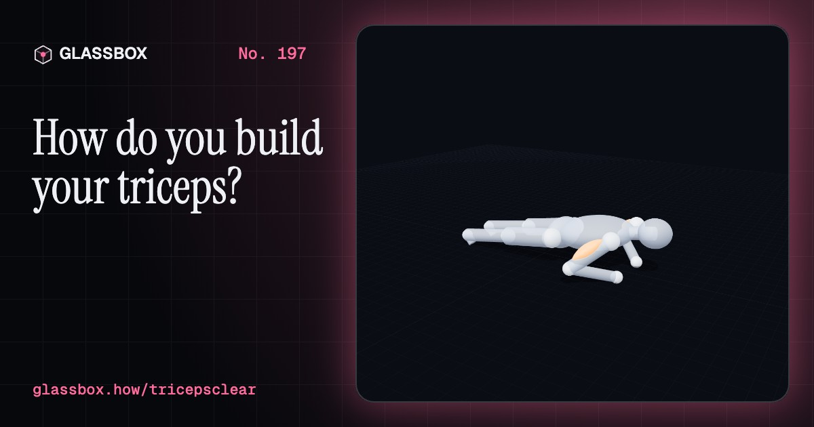
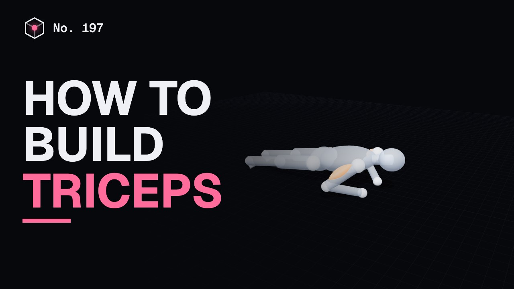
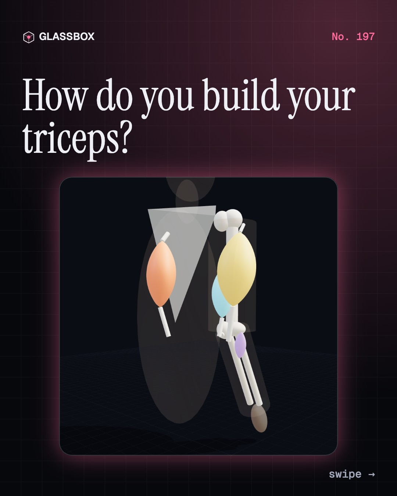
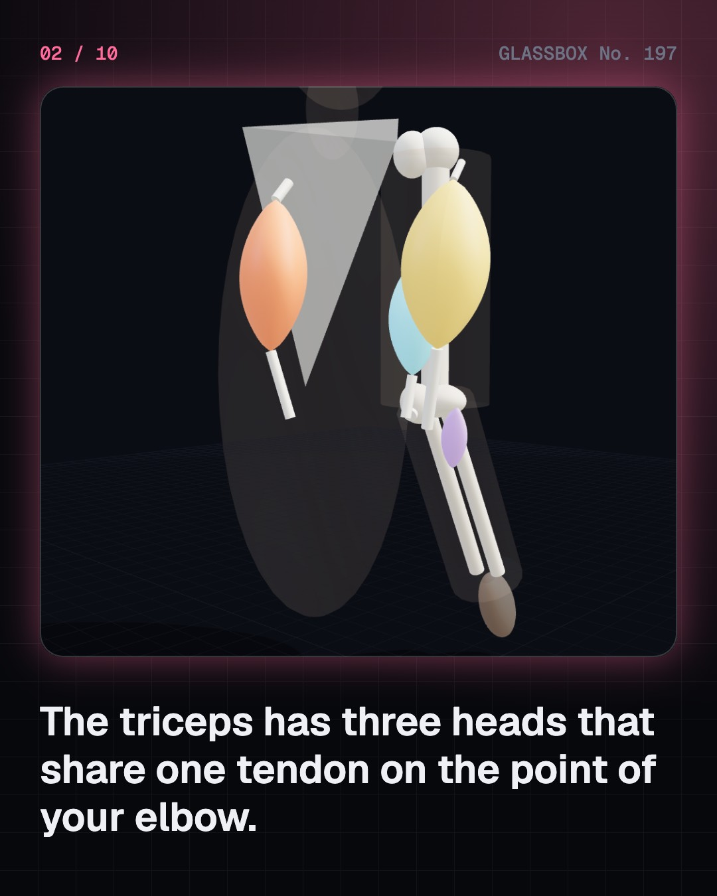
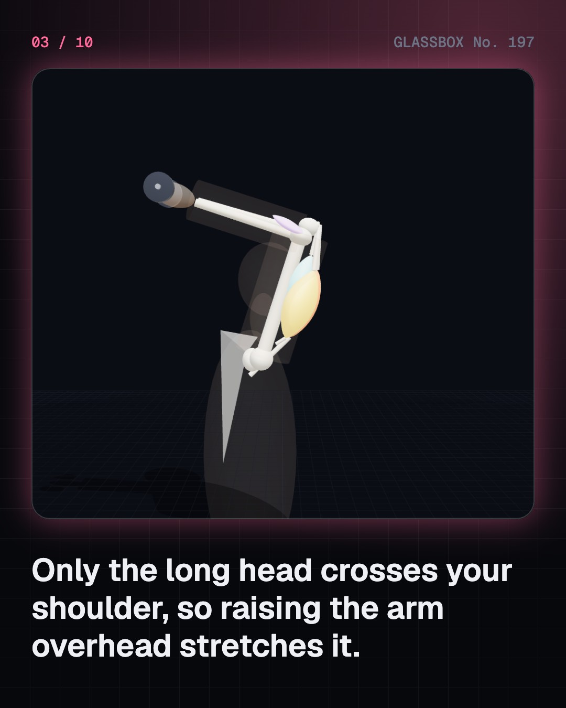
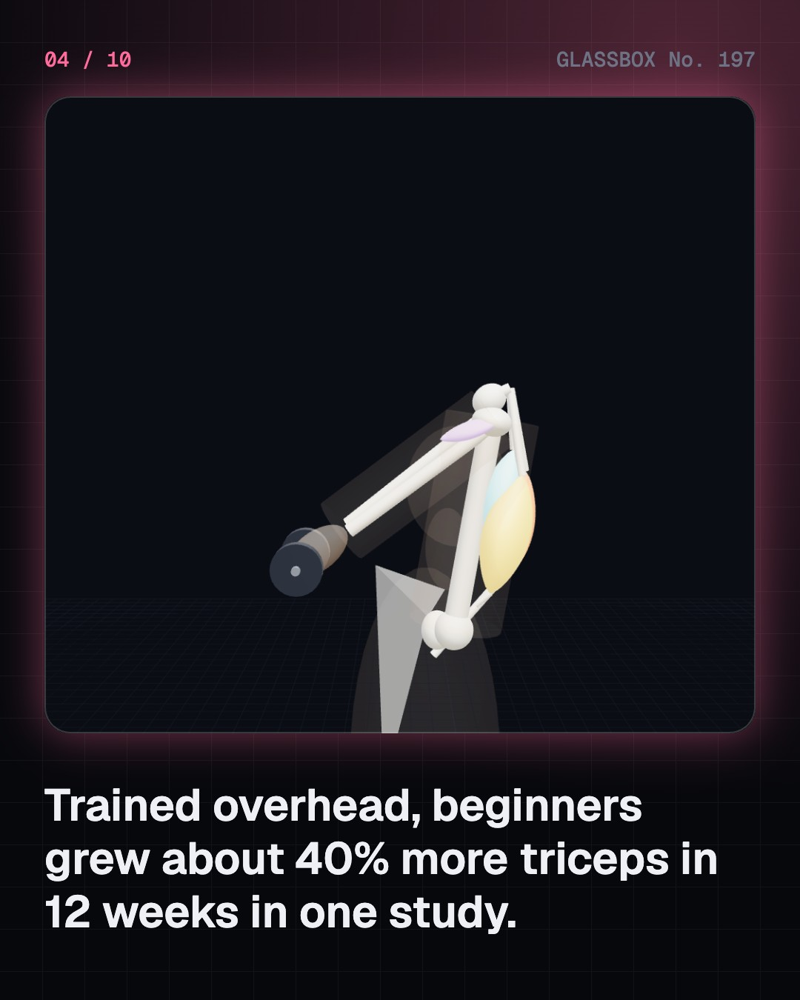

<!-- glassbox:start -->
<!-- Generated from glassbox.json by the Glassbox hub (npm run readme -- tricepsclear). Edit glassbox.json, not this block. -->
<p align="center"><a href="https://glassbox.how/e/tricepsclear/"></a></p>

<h1 align="center">TricepsClear</h1>

<p align="center"><b>How do you build your triceps?</b><br>The triceps is the biggest muscle in your upper arm, and one of its three heads crosses your shoulder. Raise the arm overhead and watch that head stretch, work out how much of you your hands carry in a push-up, a dand and a dip, and see what the evidence says about growing it safely.</p>

<p align="center"><a href="https://glassbox.how/tricepsclear/"><b>▶ Play with it</b></a> &nbsp;·&nbsp; <a href="https://glassbox.how/e/tricepsclear/">Read the 60-second explainer</a> &nbsp;·&nbsp; <a href="https://glassbox.how/tricepsclear/glassbox/reel.mp4">Watch the 40-second video</a></p>

<p align="center">
  <a href="https://glassbox.how/e/tricepsclear/"></a>
  <a href="https://glassbox.how/e/tricepsclear/"></a>
  <a href="LICENSE"></a>
  <a href="LICENSE-CONTENT.md"></a>
  <a href="#privacy"></a>
</p>

## In 60 seconds

1. **Three heads, one tendon.** The triceps brachii fills the back of the upper arm. Its long head starts on the shoulder blade, its lateral and medial heads on the humerus, and all three pull on the olecranon, the point of your elbow. By MRI it is a little over half of the upper arm's muscle, not the two-thirds often quoted.
2. **Arm up, long head long.** Only the long head crosses the shoulder, so raising the arm overhead stretches it. In one 12-week study of 21 beginners, overhead extensions grew the triceps about 20% against 14% for the arm-by-side version, with lighter weights. One study, so a strong hint rather than a law.
3. **Push-ups, dands and dips.** In a push-up your toes are the pivot and your hands carry about two-thirds of your weight; force plates measured about 64%. Knees or a bench lower that share, feet on a box raises it, and dips carry all of you. The triceps grips just 2 cm behind the elbow, so it pulls with well over a thousand newtons.
4. **How it grows.** Hard sets close to failure, about 10 or more a week, on 2 or more days, with loads anywhere from about 30% to 85% of your max. Strength comes first from your nerves; size follows over weeks. ICMR-NIN puts protein needs at about 0.83 g per kg a day from food.
5. **Safely.** See a doctor first with heart disease, high blood pressure, pregnancy or a recent injury. Warm up, build up from wall and bench push-ups, tuck the elbows, stop dips when the upper arm is level, and stop on sharp pain. Steroids harm the heart, liver and fertility and are banned by WADA and NADA.
6. **From the akhara to the lab.** Indian wrestlers trained with dands and baithaks in earth pits; Gama's huge daily counts are reports, not records. Jahn's parallel bars (1811), DeLorme's progressive resistance (1945) and today's studies on sets, loads and muscle length followed.

## Words worth knowing

| Term | Meaning |
|---|---|
| **Triceps brachii** | The three-headed muscle on the back of the upper arm that straightens the elbow. |
| **Long head** | The head that starts on the shoulder blade, so it crosses both shoulder and elbow. |
| **Olecranon** | The bony point of the elbow, where the triceps tendon attaches. |
| **Length–tension curve** | How much force a muscle can make at each length: most in the middle. |
| **Moment arm** | The sideways distance from a joint to a force; the triceps' is only about 2 cm. |
| **Dand** | The flowing Indian push-up of the akhara: hips high, swoop low, arch up. |
| **Progressive overload** | Gradually asking more of a muscle: more reps, weight or sets. |
| **Reps in reserve** | How many more reps you could have done when you stopped the set. |
| **Spot reduction** | The myth that exercising one body part burns the fat over it. |

## A short history

**From dands in the earth pits of Indian akharas and Jahn's parallel bars to MRI studies of which arm position grows the most muscle.**

- **1811** · The first parallel bars (Friedrich Ludwig Jahn, Hasenheide, Berlin)
- **1896** · Dands in print (S. Bharadwaj, Vyayama Dipika, India)
- **1910** · Gama wins in London (Ghulam Mohammad Baksh, "The Great Gama", London)
- **1945** · Progressive resistance (Thomas DeLorme, United States)
- **1966** · The length-tension curve (A. M. Gordon, Andrew Huxley and F. J. Julian, London)
- **2017** · Sets and loads (Brad Schoenfeld, Dan Ogborn, James Krieger, Jozo Grgic, United States and Croatia)
- **2023** · Overhead grows more (Sumiaki Maeo, Tadao Isaka and colleagues, Ritsumeikan University, Shiga)

The full story, with 27 moments, charts, people and 33 sources: [glassbox.how/e/tricepsclear/history](https://glassbox.how/e/tricepsclear/history/). The data lives in [`history.json`](history.json).

## Video and slides

Made with the Glassbox studio from this box's storyboard (`window.glassbox.director`). Free to reuse under CC BY 4.0.

<a href="https://glassbox.how/tricepsclear/glassbox/video.mp4"></a>

<p><a href="glassbox/slide-1.jpg"></a> <a href="glassbox/slide-2.jpg"></a> <a href="glassbox/slide-3.jpg"></a> <a href="glassbox/slide-4.jpg"></a></p>

| File | What | Size |
|---|---|---|
| [`glassbox/reel.mp4`](https://glassbox.how/tricepsclear/glassbox/reel.mp4) | Reel / Short, with captions and soundtrack | 1080×1920 |
| [`glassbox/video.mp4`](https://glassbox.how/tricepsclear/glassbox/video.mp4) | YouTube video, with captions and soundtrack | 1920×1080 |
| `glassbox/slide-1…10.jpg` | Instagram carousel | 1080×1350 |
| `glassbox/thumb.jpg` | YouTube thumbnail | 1280×720 |
| `glassbox/cover.jpg` | Share card and repo social preview | 1200×630 |
| [`glassbox/history-reel.mp4`](https://glassbox.how/tricepsclear/glassbox/history-reel.mp4) | “History in 10 moments” Reel / Short | 1080×1920 |
| `glassbox/history-slide-*.jpg` | History carousel | 1080×1350 |
| `glassbox/post.json` | Post copy and schedule used by the publish kit | |

## Privacy

This box has no accounts and no ads, and it ships its own fonts and libraries. When you run it yourself it sends nothing anywhere. On glassbox.how, the site's `/bar.js` also loads Glassbox's analytics: **Google Analytics** to count visits (it asks first in the EU, UK and Switzerland, and stays off when your browser sends Global Privacy Control or Do Not Track) and **ClickTrust** to detect bots.

It remembers a few things **in your own browser only**, and never sends them anywhere:

| Browser storage key | What it holds |
|---|---|
| `tricepsclear.v1` | Which chapters you have opened, your best quiz scores, and sound on or off. |

Exactly what each one sees is at [glassbox.how/privacy](https://glassbox.how/privacy/).

## Licences

- **Code:** [MIT](LICENSE). Use it, change it, ship it.
- **Explanations, text, images and videos** (`glassbox.json`, `glassbox/`): [CC BY 4.0](LICENSE-CONTENT.md). Credit “Glassbox, glassbox.how/e/tricepsclear”.
- **Third-party parts** keep their own licences: [three.js](https://threejs.org) (MIT), [Geist, Instrument Serif](https://openfontlicense.org) (SIL OFL 1.1).
- The Glassbox name and logo aren't covered by either licence. See the [terms](https://glassbox.how/terms/).

Found a mistake? [Open an issue](https://github.com/bdeeps/tricepsclear/issues). Corrections happen in public.
<!-- glassbox:end -->

## Run it

It's plain HTML, CSS and JavaScript. No build step and no dependencies. Run locally, it contacts no other website.

```bash
python3 -m http.server 8000
```

Three.js and the fonts ship in `vendor/` and `fonts/`, so it also works offline.

Then open http://localhost:8000.

## How it's built

| File | What |
|---|---|
| `index.html`, `css/app.css` | The page and its styles |
| `js/app.js`, `js/stage.js`, `js/ui.js`, `js/kit.js` | The shared Glassbox 3D engine: chapters, 3D stage, controls, quiz, video director |
| `js/chapters/*.js` | One file per chapter: the 3D model, controls, text, key terms, quiz and video scenes |
| `js/triceps.js` | The physics, testable without a browser: head lengths and the length–tension curve, elbow torque for each exercise, push-up, dand and dip loads, the illustrative growth model, with sources |
| `js/figure.js` | The 3D models: the anatomical arm with its three triceps heads, the jointed mannequin, benches, bars, the akhara pit and gada |
| `glassbox.json` | Title, question, explainer beats, key terms, browser storage and credits shown on glassbox.how |
| `reel` in each chapter | The storyboard the Glassbox studio records into short videos |
| `glassbox/` | The published video, slides, thumbnail and post copy |
| `fonts/`, `vendor/three/` | Self-hosted Geist and Instrument Serif (SIL OFL 1.1) and three.js (MIT) |
